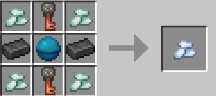

# Whats an Attribute Crystal?

The Attribute Crystal is the main component of this plugin, when consumed by right-clicking, it increments your crystal level.
It is crafted like this:

Or you can get it by killing a player that has a crystal level above -2 (minimum you can get). Getting killed by a player will decrease your crystal level if it isn't at the minimum (-2).
You can consume the Crystal only if you have a level under 5 (max level).
Consuming a Crystal launches an animation. You can skip this animation by sneaking while the animation plays or by sneaking when consuming the crystal to skip it entirely.

# What does the crystal level do?

The crystal level is in a range between -2 and 5 (inclusive). The greater it is, the more buffed you'll get, with different attribute boosts like max health, damage, mining speed, etc...

### Boost Table Ref:

| Level | Max Health (2 hp = 1 heart) | Attack Damage | Entity Interaction | Block Interaction | Mining Efficiency |
| ----- | --------------------------- | ------------- | ------------------ | ----------------- | ----------------- |
| 5     | +10 hp                      | +2.5          | +1.25              | +1.25             | +0.25             |
| 4     | +8 hp                       | +2            | +1                 | +1                | +0.2              |
| 3     | +6 hp                       | +1.5          | +0.75              | +0.75             | +0.15             |
| 2     | +4 hp                       | +1            | +0.5               | +0.5              | +0.1              |
| 1     | +2 hp                       | +0.5          | +0.25              | +0.25             | +0.05             |
| 0     | +0 hp                       | +0            | +0                 | +0                | +0                |
| -1    | -2 hp                       | -0            | -0.25              | -0.125            | -0.05             |
| -2    | -4 hp                       | -0            | -0.5               | -0.25             | -0.1              |

# List of commands

**All commands are a sub command of /crystals**

- `currentupgrade
	- Shows the upgrade you currently have, based on your crystal level.
- `amount`
	- Shows how many Attribute Crystals you have. It also previews the next upgrade you would get, or tells you you're at max level if there isn't one.
- `withdraw`
	- Removes one crystal from your level and gives you a Crystal item. Your attributes are refreshed straight away to match the lower level. You can't withdraw if you're already at the minimum level.
- `refresh`
	- Saves your player data and re-applies your attribute modifiers. Useful if your stats look out of sync.
- `listupgrades`
	- Lists every upgrade from the minimum level to the maximum level.

**Note**
> If you run `/crystals amount` while being at level -1 or `/crystals listupgrades`, it is likely that the level 0 doesn't show anything because it gives no upgrade